# C3: the editor's components

The projects the editor is built from, and the plugin contract between them and the plugins. A component named for a project is that project: `ComponentDiagramTests` fails when those components, or the arrows between them, disagree with the project files. The plugin contract is drawn in orange. The C4 views are listed in the [README](README.md).

```mermaid
flowchart TB
    classDef system fill:#1168bd,stroke:#0b4884,color:#fff
    classDef component fill:#85bbf0,stroke:#5d82a8,color:#000
    classDef contract fill:#f5a623,stroke:#c47f0e,color:#000
    classDef store fill:#438dd5,stroke:#2e6295,color:#fff
    classDef external fill:#999999,stroke:#6b6b6b,color:#fff

    subgraph editor["Editor"]
        desktop["<b>Flyback.Editor.Desktop</b><br/>[Component: .NET project]<br/>The program: startup, installing an update, and the plugins it ships."]:::component
        editorLib["<b>Flyback.Editor</b><br/>[Component: .NET project]<br/>The window, the canvas, the inspector, the assistant column and recording, with no platform in it."]:::component
        ui["<b>Flyback.Ui</b><br/>[Component: .NET project]<br/>What the editor and the viewer draw with: the preview, the sound device, MIDI and colors."]:::component
        assist["<b>Flyback.Assist</b><br/>[Component: .NET project]<br/>The host's side of a conversation with an assistant."]:::component
        host["<b>Flyback.Host</b><br/>[Component: .NET project]<br/>What every host reads: the output settings, the sizes, the saved presets."]:::component
        pluginHost["<b>Flyback.Plugins</b><br/>[Component: .NET project]<br/>The plugin contract, and the host that loads plugins off disk."]:::contract
        gpu["<b>Flyback.Gpu</b><br/>[Component: .NET project]<br/>The GPU renderer, its OpenGL binding and a headless context."]:::component
        engine["<b>Flyback.Engine</b><br/>[Component: .NET project]<br/>The compiler, the four backends, the renderers, the text language and file I/O."]:::component
        core["<b>Flyback.Core</b><br/>[Component: .NET project]<br/>The patch model, the module catalog, the opcodes and the Emitter."]:::contract
        shippedPlugins["<b>Shipped plugins</b><br/>[Component: .NET projects]<br/>Sound and MIDI, secret stores, assistants, the decision model and modules, each in its own folder under plugins."]:::component
    end
    dataFolder[("<b>Data folder</b><br/>[Container: Files]<br/>settings.json, allowed plugins, saved presets, conversations and recovery.")]:::store
    pluginsFolder[("<b>Plugins folder</b><br/>[Container: Files]<br/>The shipped plugins and installed plugin packages, beside the programs.")]:::store
    presetSite["<b>Preset site</b><br/>[Software System]<br/>The plugin site and preset site at flybackmodular.app."]:::system
    github["<b>GitHub</b><br/>[Software System]<br/>Releases signed builds."]:::external
    providers["<b>Assistant providers</b><br/>[Software System]<br/>OpenAI-style and Gemini endpoints, and the codex program."]:::external
    decisionModel["<b>Decision model server</b><br/>[Software System]<br/>Answers typed questions with a probability."]:::external
    aptabase["<b>Aptabase</b><br/>[Software System]<br/>Counts anonymous usage."]:::external
    secretStore["<b>Secret store</b><br/>[Software System]<br/>The operating system's keychain."]:::external
    ffmpeg["<b>ffmpeg</b><br/>[Software System]<br/>Encodes takes and decodes MP3 samples."]:::external
    devices["<b>Sound and MIDI devices</b><br/>[Software System]<br/>The speakers, the sound input and MIDI controllers."]:::external

    desktop -- "Runs" --> editorLib
    editorLib -- "Holds conversations through" --> assist
    editorLib -- "Draws and plays with" --> ui
    ui -- "Draws the picture with" --> gpu
    ui -- "Reads settings and presets through" --> host
    assist -- "Asks assistants through" --> pluginHost
    host -- "Uses" --> pluginHost
    gpu -- "Compiles shaders with" --> engine
    pluginHost -- "Compiles patches with, out of a plugin's reach" --> engine
    engine -- "Compiles" --> core
    pluginHost -- "Loads, each in its own load context" --> shippedPlugins
    shippedPlugins -- "Compiled against" --> pluginHost
    shippedPlugins -- "Compiled against" --> core
    desktop -- "Downloads releases from<br/>[HTTPS]" --> github
    editorLib -- "Checks for releases on<br/>[HTTPS]" --> github
    editorLib -- "Fetches and shares presets and plugins, sends letters to<br/>[HTTPS]" --> presetSite
    editorLib -- "Sends anonymous usage counts to<br/>[HTTPS]" --> aptabase
    editorLib -- "Keeps settings, layout and recovery in" --> dataFolder
    editorLib -- "Installs plugin packages into" --> pluginsFolder
    assist -- "Keeps conversations in" --> dataFolder
    host -- "Keeps saved presets in" --> dataFolder
    pluginHost -- "Loads plugins from" --> pluginsFolder
    engine -- "Encodes takes and decodes MP3 samples with<br/>[Local process]" --> ffmpeg
    shippedPlugins -- "Asks the assistant through<br/>[HTTPS, local process]" --> providers
    shippedPlugins -- "Asks typed questions of<br/>[HTTP]" --> decisionModel
    shippedPlugins -- "Keeps API keys in" --> secretStore
    shippedPlugins -- "Plays sound to, and hears sound input and MIDI from" --> devices
```

