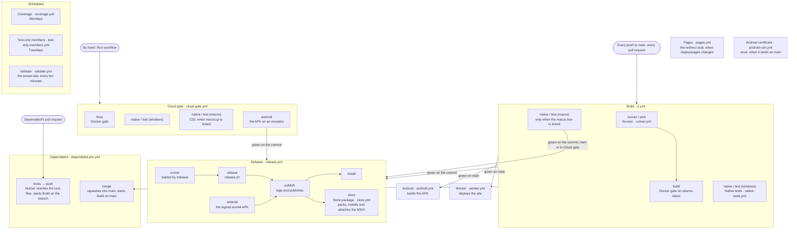

# The pipeline

What runs on GitHub Actions, by the name each workflow has in the Actions tab and the
file it is in. The rules it keeps are in [pipeline.md](../agents/rules/pipeline.md);
why it runs where it does is ADR-0195. `PipelineDiagramTests` fails when a workflow is
added, renamed or removed and this page does not say so.

Build, Coverage and Release each have a `self-hosted` box under Run workflow. Ticked
on `main`, `runner.yml` puts the Docker gate on the Linux self-hosted runner if it is
online, else the Windows one, else GitHub's. Nothing a push or a pull request starts
runs on a self-hosted machine.

Build's `macos` box adds the macOS leg, which a push leaves out for its cost (ADR-0200).
