# The pipeline

What runs on GitHub Actions, by the name each workflow has in the Actions tab and the
file it is in. The rules it keeps are in [pipeline.md](../agents/rules/pipeline.md);
why it runs where it does is ADR-0212. `PipelineDiagramTests` fails when a workflow is
added, renamed or removed and this page does not say so.

```mermaid
flowchart TB
    push(["Every push to main, every pull request"]) --> build
    hand(["By hand: Run workflow"]) --> cloud
    daily(["Daily on main"]) --> c_android

    subgraph build["Build · ci.yml"]
        b_gate["build<br/>Docker gate on ubuntu-latest"]
        b_win["native / test (windows)<br/>Native tests · native-tests.yml"]
        b_mac["native / test (macos)"]
    end

    subgraph cloud["Cloud gate · cloud-gate.yml"]
        c_linux["linux<br/>Docker gate"]
        c_win["native / test (windows)"]
        c_mac["native / test (macos)<br/>CGL when macos-gl is ticked"]
        c_android["android<br/>the APK on an emulator, daily too"]
    end

    build -- "green on main" --> apk["Android · android.yml<br/>builds the APK"]
    build -- "green on main" --> site["Worker · worker.yml<br/>deploys the site"]
    build -- "green on the commit" --> release
    c_android -- "green on the commit" --> release
    b_mac -- "green on the commit" --> release

    subgraph release["Release · release.yml"]
        r_release["release<br/>release.sh, started by /release"] --> r_publish["publish<br/>tags and publishes"] --> r_install["install"]
        r_android["android<br/>the signed arm64 APK"] --> r_publish
        r_publish --> r_store["store<br/>Store package · store.yml<br/>packs, installs and attaches the MSIX"]
    end

    subgraph scheduled["Scheduled"]
        coverage["Coverage · coverage.yml<br/>daily"]
        members["Test-only members · test-only-members.yml<br/>daily"]
        validate["Validate · validate.yml<br/>the preset site, every ten minutes"]
    end
    coverage -- "failed" --> tell["Tell · tell.yml<br/>opens or comments on an issue"]
    members -- "failed" --> tell
    c_android -- "failed on the schedule" --> tell
    ios -- "failed on the schedule" --> tell

    pages["Pages · pages.yml<br/>the redirect stub, when deploy/pages changes"]
    hand --> ios["iOS · ios.yml<br/>builds the iOS editor and plays it in the simulator"]
    daily --> ios

    bot(["Dependabot's pull request"]) --> d_locks
    subgraph dependabot["Dependabot · dependabot-prs.yml"]
        d_locks["locks → push<br/>NuGet: rewrites the lock files, starts Build on the branch"]
        d_merge["merge<br/>squashes into main, starts Build on main"]
    end
    build -- "green on a Dependabot branch" --> d_merge
```

Every job runs on GitHub's standard runners; nothing runs on a self-hosted machine.

Every push runs macOS; the Android emulator and the iOS simulator run daily (ADR-0212).
